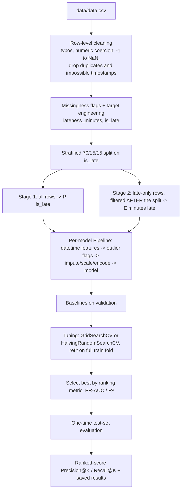

# MoveEasy Delivery Risk Scoring

A two-stage ("hurdle") machine learning pipeline that scores every delivery **at dispatch time** for the risk of arriving late. It gives the dispatch team a ranked work-list (about 200 drivers, last-mile parcel delivery in Singapore) so they can reassign drivers, re-sequence routes or contact customers before a delivery fails.

For each delivery the pipeline produces two numbers:

- **Stage 1 – classification:** `P(is_late)`, the probability the delivery arrives after its promised time. It is trained on every row.
- **Stage 2 – regression:** `E[lateness_minutes | is_late]`, how many minutes late it is expected to be if it is late. It is trained on late deliveries only.

Together they give a risk score of `P(is_late) × E[lateness_minutes | is_late]`. The two components can also be shown separately, because "probably late by a little" and "unlikely but very late" call for different actions.

The pipeline is modular and config-driven. Every path, column name, cleaning rule and hyperparameter grid lives in `src/config.yaml`, and every model is a scikit-learn `Pipeline`, so preprocessing statistics are learned only from training data.

```
.
├── main.py                  # orchestration: run the whole pipeline end to end
├── requirements.txt
├── eda.ipynb                # full EDA + modelling notebook (source of the design decisions)
├── src/
│   ├── config.yaml          # single source of truth for the pipeline
│   ├── data_preparation.py  # cleaning, target engineering, preprocessing pipeline
│   └── model_training.py    # split, baselines, tuning, checkpointing, evaluation
├── data/
│   ├── delivery.db          # raw SQLite database (tables: deliveries, feedback)
│   └── data.csv             # exported from delivery.db (see step 2 below)
└── outputs/                 # created on first run: models, results, checkpoints
```

---

## Prerequisites and Installation

- Python 3.9 or newer (developed on 3.11)
- The packages in `requirements.txt`: pandas, numpy, scikit-learn, scipy, PyYAML, joblib. The EDA notebook additionally needs Jupyter and a plotting library.

```bash
# 1. create and activate a virtual environment
python -m venv .venv
source .venv/bin/activate        # Windows: .venv\Scripts\activate

# 2. install dependencies
pip install -r requirements.txt
```

**Data.** `main.py` reads a flat CSV (`data.raw_path: "data/data.csv"` in `config.yaml`), but the raw data ships as the SQLite file `data/delivery.db`. Export the `deliveries` table once before the first run:

```bash
python -c "import sqlite3, pandas as pd; \
con = sqlite3.connect('data/delivery.db'); \
pd.read_sql('SELECT * FROM deliveries', con).to_csv('data/data.csv', index=False)"
```

The `feedback` table (post-delivery ratings and comments) is not a model input. It does not exist at dispatch time and was used only in the EDA to validate the target.

---

## Instructions for Executing the Pipeline

Run from any directory. All paths are resolved relative to `main.py`.

```bash
# full pipeline: baselines -> tuning -> final test evaluation -> ranked-score demo
python main.py

# quick check: fit baseline models only, skip tuning and test evaluation
python main.py --skip-tuning

# use a different config file
python main.py --config path/to/other_config.yaml

# run the self-tests embedded in the data preparation module
python src/data_preparation.py
```

Tuning is **checkpointed**: each tuned model is saved to `outputs/checkpoints/ledger.json` and `outputs/models/` as soon as it finishes. If a run is interrupted, re-running resumes from where it stopped. Delete `outputs/` for a completely clean run.

**Outputs** (written to `outputs/results/`):

| File | Content |
|---|---|
| `baseline_results_stage{1,2}.csv` | Validation metrics for default-hyperparameter models |
| `tuned_results_stage{1,2}.csv` | Validation metrics after hyperparameter tuning |
| `final_test_results.json` | One-time test-set metrics for the selected model of each stage |
| `final_test_precision_recall_at_k.csv` | Ranked-score (Precision@K / Recall@K) table on the test set |
| `closing_summary.csv` | Baseline vs. tuned vs. test for the ranking metric of each stage |

Trained pipelines (preprocessing and model together) are saved as `.joblib` files in `outputs/models/`.

**Changing parameters.** Edit `src/config.yaml`; no source changes are needed. Common edits:

| To change | Edit |
|---|---|
| Input data path | `data.raw_path` |
| Split proportions, random seed | `split.*`, `random_state` |
| Which models are compared, and their search grids | `models.classification.registry`, `models.regression.registry` |
| Cross-validation folds, tuning subsample size, halving factor | `tuning.*` |
| Imputation, scaling, encoding, IQR outlier multiplier | `missing_value_imputation`, `preprocessing`, `outlier_handling` |
| Class-imbalance handling | `class_imbalance.*` |
| Metrics and the ranking metric used to pick the final model | `evaluation.*` |
| K values for the ranked-score evaluation | `evaluation.ranked_score.k_fractions` |

---

## Description of Logical Steps/Flow of the Pipeline



1. **Load config** (`main.py`). Relative paths are resolved against the project root.
2. **Load and clean** (`data_preparation.prepare_raw_data`). These steps are deterministic and learn nothing from the data, so they run once before the split without leakage risk:
   - Drop identifier columns (`delivery_id`, `client_id`, `driver_id`).
   - Parse the four datetime columns.
   - Normalise typos and casing in `branch`, `parcel_category` and `vehicle_type`.
   - Coerce numeric-looking text columns to numbers and recode the `-1` sentinel to `NaN`.
   - Drop rows where delivery precedes pickup, and drop exact duplicates.
   - Add a `<col>_was_missing` flag for each of 7 columns.
   - Engineer the targets: `lateness_minutes = delivery_datetime − promised_delivery_datetime` (in minutes) and `is_late = lateness_minutes > 0`.
3. **Split** (`model_training.split_data`). A 70/15/15 train/validation/test split, stratified on `is_late` and shared by both stages. Stage 2's late-only subsets are carved out of these same splits afterwards, so the regressor never influences how the classifier's folds were chosen.
4. **Preprocess** (`data_preparation.build_preprocessing_pipeline`). A fresh, unfitted pipeline is built per model and fitted on the training fold only:
   1. `DatetimeFeatureTransformer` adds the temporal features.
   2. `OutlierFlagTransformer` learns IQR fences and adds outlier flags.
   3. A `ColumnTransformer` applies median imputation and standard scaling to numeric columns, and constant imputation and one-hot encoding to categorical columns.
5. **Baselines.** Every model in the registry, plus a naive benchmark, is fitted with library defaults and scored on the validation fold.
6. **Tuning.** `GridSearchCV` is used for the "linear" family and `HalvingRandomSearchCV` for the "tree" family, each with 3-fold CV. For Stage 1, the tree search runs on a stratified 25,000-row subsample to save compute. The winning hyperparameters are always **refit on the full training fold** before any metric is reported.
7. **Selection and final test.** The best tuned model per stage (highest PR-AUC for Stage 1, highest R² for Stage 2) is chosen on validation metrics and evaluated **once** on the held-out test set.
8. **Ranked-score evaluation.** Precision@K and Recall@K are computed on the test set using the Stage 1 scores, then all results are saved.

---

## Overview of Key Findings from EDA

The detailed analysis is in `eda.ipynb` (Sections 1–10). The cleaned dataset has about **149.5k deliveries**. Key points:

- **Class imbalance.** About 11% of deliveries are late. The median delivery arrives about 17 minutes early, but the lateness distribution has a very long right tail (heavily skewed, up to 1,500+ minutes).
- **The target is meaningful.** Late deliveries receive significantly lower customer ratings (negative, significant correlation), so lateness is a valid proxy for service failure.
- **Data quality issues.** These shaped the cleaning step:
  - 750 exact duplicate rows.
  - About 478 rows with a delivery time before the pickup time.
  - Typos and casing variants in `branch`, `parcel_category` and `vehicle_type`.
  - Numeric columns stored as text, with `-1` used as a missing-value marker.
  - About 4% missingness spread across seven unrelated columns, which looks like random corruption.
- **No single dominant driver.** Numeric correlations with lateness are weak (all |r| < 0.2). `num_stops_on_route` and `distance_km` are strongest (r ≈ 0.16), and more experienced drivers run slightly less late (r ≈ −0.085). `parcel_weight_kg` and `parcel_value_sgd` carry almost no signal.
- **Categorical effects:**
  - `parcel_category` is the clearest driver: refrigerated parcels are 22.4% late, oversized 18.4%, fragile 12.8% and standard 9.3%.
  - `delivery_priority` runs against intuition: Standard is the worst tier (14.0% late) and VIP the best (3.7%), so dispatch already favours VIP.
  - Branch matters: East is 13.9% late against 7.7% for Central.
  - Postal zone shows a real spread (7.1–14.7% among high-volume zones).
  - `vehicle_type` is negligible, and `payment_method` (COD vs. prepaid) is **not** a significant driver.
- **Interactions.** `parcel_category × delivery_priority` spans 2.9% to 26.9% late. The riskiest segment is refrigerated or oversized parcels on the Standard tier. `branch × vehicle_type` adds nothing beyond `branch`.
- **Outliers are informative but modest.** Rows with extreme numeric values are slightly more often late (12.0% vs 10.7%), with the difference concentrated in the tail. They are kept and flagged, not capped or removed.
- **Why a hurdle model.** The target mixes a rare "will it fail" event with a skewed "how bad" tail. A single regressor on the full target did no better than a naive mean on MAE. Fitting severity only on late rows gives a much better-behaved target (R² ≈ 0.24 in the baselines).
- **Why a ranked score.** At the default 0.5 threshold, recall for the best baseline models was only 1–3%, even though PR-AUC was well above the base rate. 0.5 is the wrong cut-off for an 11%-positive problem, so the recommended deliverable is a risk-sorted list that dispatch works down according to capacity.

---

## Feature Handling Description

All inputs are restricted to what is known **at dispatch time**.

- `delivery_datetime`, the outcome timestamp, is excluded to avoid target leakage.
- `feedback.rating` and `feedback.comment` are excluded because they are post-delivery.
- ID columns are dropped.

| Feature group | Columns | Cleaning / processing |
|---|---|---|
| Numeric (raw) | `distance_km`, `parcel_weight_kg`, `parcel_value_sgd`, `num_stops_on_route`, `driver_experience_months` | Coerce text to numeric; recode `-1` to `NaN`; median imputation (fit on train only); standard scaling |
| Categorical | `branch`, `parcel_category`, `delivery_priority`, `vehicle_type`, `payment_method`, `recipient_postal_code` | Fix casing and typos; trim whitespace; postal code kept as a string category (a zone ID, not a quantity); missing values filled with `"missing"`; one-hot encoding with unknown categories ignored |
| **Engineered:** temporal | `pickup_hour`, `pickup_dayofweek`, `pickup_is_weekend`, `promised_window_minutes` (promised − pickup), `booking_lead_minutes` (pickup − booking) | Derived from `booking_datetime`, `pickup_datetime` and `promised_delivery_datetime`; stateless, so no leakage; then scaled |
| **Engineered:** missingness flags | `<col>_was_missing` for `parcel_weight_kg`, `parcel_value_sgd`, `num_stops_on_route`, `driver_experience_months`, `vehicle_type`, `payment_method`, `recipient_postal_code` | Created before imputation, so missingness itself can carry signal |
| **Engineered:** outlier flags | `<col>_is_outlier` for the five raw numeric columns | IQR fences (1.5×) learned on the training fold only; original values left untouched |
| Raw datetimes | `booking_datetime`, `pickup_datetime`, `promised_delivery_datetime` | Used only to derive the temporal features; not passed to the model directly |
| Dropped | `delivery_id`, `client_id`, `driver_id`, `delivery_datetime` | Identifiers (high-cardinality, risk of overfitting to identity) and the outcome timestamp |
| Targets | `is_late` (Stage 1), `lateness_minutes` (Stage 2, late rows only) | Derived from `delivery_datetime` vs. `promised_delivery_datetime` |

In total there are 22 scaled numeric columns (5 raw, 5 temporal, 7 missingness flags, 5 outlier flags) plus the one-hot encoded categoricals.

---

## Explanation of Model Choices

**Architecture: a two-stage hurdle model.** The business asks for a *probability* of failure and an *estimated severity*. A single regressor on `lateness_minutes` has to serve two jobs with one loss function, and the target is a spike of on-time deliveries plus a sparse tail. Splitting it into a classifier and a conditional regressor gives two models that each fit a simpler problem. Both share one preprocessing pipeline.

**Naive benchmarks.** Each stage includes a naive baseline that every real model must beat: a stratified `DummyClassifier` (it guesses at the base rate, giving a meaningful ROC/PR reference) and a mean `DummyRegressor`.

**Stage 1 – classifiers (`is_late`)**

| Model | Why it is included |
|---|---|
| Logistic Regression | Interpretable, fast, strong linear baseline for ranking |
| K-Nearest Neighbors | Non-parametric reference point (expected to suffer in a wide one-hot space) |
| Decision Tree | Simple non-linear model; regularised through tuning |
| Random Forest | Variance-reduced tree ensemble that captures interactions such as `parcel_category × delivery_priority` |
| Gradient Boosting | Strong tabular learner; led the notebook's PR-AUC comparison |

**Stage 2 – regressors (`lateness_minutes | is_late`)**

| Model | Why it is included |
|---|---|
| Linear / Ridge / Lasso | The late-only relationship was close to additive, and regularisation helps the much smaller training set (about 11.5k rows) |
| Decision Tree, Random Forest | Capture non-linear effects and interactions, with depth and leaf size constrained |

**Class imbalance.** With about 11% positives, `class_weight="balanced"` is fixed (not searched) for the Logistic, Decision Tree and Random Forest classifiers. Gradient Boosting has no `class_weight`, so a balanced `sample_weight` is applied at the final refit. KNN supports neither and is trained unweighted. Stage 2 is not weighted because it is already restricted to late rows.

**Search strategy.** Linear-family models use a small `GridSearchCV`. Tree-family models use `HalvingRandomSearchCV`, which suits larger grids. Searching on a 25,000-row stratified subsample keeps Stage 1 tuning affordable, and the winner is always refit on the full training fold.

> The `eda.ipynb` notebook also compared Ridge Classifier, L1-Logistic, and Gradient Boosting / KNN regressors. The production registry in `config.yaml` is a leaner subset. To add or remove a model, edit `models.*.registry` and, for a new estimator class, add it to `_ESTIMATOR_MODULES` in `src/model_training.py`.

---

## Evaluation of Models

**Metrics and why they were chosen**

| Stage | Metrics | Ranking metric | Rationale |
|---|---|---|---|
| 1 – classification | Accuracy, Precision, Recall, F1, ROC-AUC, PR-AUC | **PR-AUC** | With about 11% positives, accuracy is misleading (about 89% from predicting "on time" every time) and ROC-AUC looks optimistic. PR-AUC measures how well late deliveries are ranked above on-time ones, independent of threshold. |
| 1 – ranked score | Precision@K, Recall@K | n/a | Matches how dispatch will use the output: review the top K% of the risk-sorted list. |
| 2 – regression | MAE, MSE, RMSE, R² | **R²** | Standard regression ranking; MAE is reported in minutes, so it is directly readable by dispatchers. |

Stage 2 is evaluated on late deliveries only, since its job is "how late, given that it is late".

**Results.** These figures were produced by the full set of models in `eda.ipynb` (Sections 20–26), where Gradient Boosting won both stages. `python main.py` writes the equivalent files to `outputs/results/` for the leaner registry in `config.yaml`, so its Stage 2 numbers and selected model may differ slightly.

*Stage 1 – `P(is_late)`, Gradient Boosting*

| Metric | Baseline (validation) | Tuned (validation) | Final (test) |
|---|---|---|---|
| PR-AUC | 0.271 | 0.271 | **0.274** |
| Recall at 0.5 threshold | 0.010 | 0.693 | 0.685 |
| ROC-AUC | n/a | n/a | 0.734 |
| Precision at 0.5 threshold | n/a | n/a | 0.200 |

PR-AUC is about 2.5× the 11% base rate (naive dummy: 0.109). Tuning barely changed PR-AUC. The large recall gain comes from the class-weighting decision, which moves the probability scale, not the ranking quality.

*Stage 1 – ranked-score evaluation on the test set*

| Share of deliveries reviewed (K) | Precision@K | Recall@K |
|---|---|---|
| 5% | 38.0% | 17.3% |
| 10% | 31.7% | 28.9% |
| 20% | 25.9% | 47.1% |
| 30% | 21.9% | 59.7% |
| 40% | 19.4% | 70.5% |
| 50% | 17.3% | 78.4% |

Reviewing the riskiest 20% of deliveries catches about 47% of the late ones at about 2.3× the base-rate precision.

*Stage 2 – `E[lateness_minutes | is_late]`, Gradient Boosting*

| Metric | Baseline (validation) | Tuned (validation) | Final (test) |
|---|---|---|---|
| R² | 0.195 | 0.247 | **0.215** |
| MAE (minutes) | 50.4 | 49.7 | 49.6 |
| RMSE (minutes) | n/a | n/a | 68.4 |

The naive mean predictor scores R² ≈ 0 and MAE ≈ 56 minutes. The linear models were within 0.01 of Gradient Boosting on validation R² (about 0.243), which supports an approximately additive severity relationship.

**Honest reading.** Lateness here is a multi-cause operational problem with no dominant driver, so these are real but modest results (PR-AUC about 0.27, R² about 0.2). The value of the pipeline is a **usefully ranked, reproducible risk score**, not a near-perfect classifier. Stage 2 shows a validation-to-test gap (0.247 to 0.215) because it trains on far fewer rows, which is worth monitoring in a pilot.

---

## Considerations for Deployment

- **Serve the ranking, not a threshold.** Present deliveries sorted by risk score and let dispatchers work down the list as capacity allows. This needs no retraining and adapts to staffing. Expose `P(is_late)` and expected minutes late as separate sortable columns, as well as the combined score, because they suggest different actions (reassign a driver vs. proactive customer outreach). The hurdle score `P(is_late) × E[minutes | late]` still has to be composed from the two saved models. `main.py` does not compute it.
- **Calibration.** Class weighting shifts probabilities upward, so the raw scores are good for ranking but are **not** literal probabilities. If anything downstream consumes them as numbers, add `CalibratedClassifierCV` on a held-out slice. Calibration does not change the ranking.
- **Scoring interface.** Each saved `.joblib` file contains preprocessing and model together. Scoring a new delivery needs only the raw dispatch-time columns and `pipeline.predict_proba()` (Stage 1) or `pipeline.predict()` (Stage 2). Input must match the training schema (cleaned casing, numeric types, parsed datetimes), so reuse `clean_structural_errors` from `data_preparation.py` in the serving path.
- **Leakage guard.** Only features available at booking or pickup may be fed in. Never include `delivery_datetime` or feedback fields.
- **Latency and scale.** Scoring is a single pass through an sklearn pipeline, so batch scoring at shift start or on each booking is cheap at fleet scale. Training and tuning take on the order of 10–15 minutes on a single CPU.
- **Monitoring and retraining.** Track the late rate, PR-AUC, Recall@K and Stage 2 MAE on recent deliveries. Watch for drift in categorical mixes (new branches, parcel types, postal zones) and for the 4% missingness pattern changing. Retrain on a schedule or when metrics degrade. The checkpoint ledger makes re-runs resumable.
- **Pilot and success criteria.** Validate in a pilot against the business goals: fewer late deliveries, better customer ratings, and dispatcher adoption. Choose K from real shift capacity, and measure whether interventions on top-K deliveries actually reduce lateness. Model scores alone cannot prove that.
- **Fairness and operations.** Features such as postal zone and branch can encode operational disadvantages. Review whether score-driven reassignments load particular drivers or areas disproportionately.
- **Data pipeline.** Replace the manual `delivery.db` → `data.csv` export with a scheduled extract from the source system, and keep the config the single place where columns and rules are defined.
